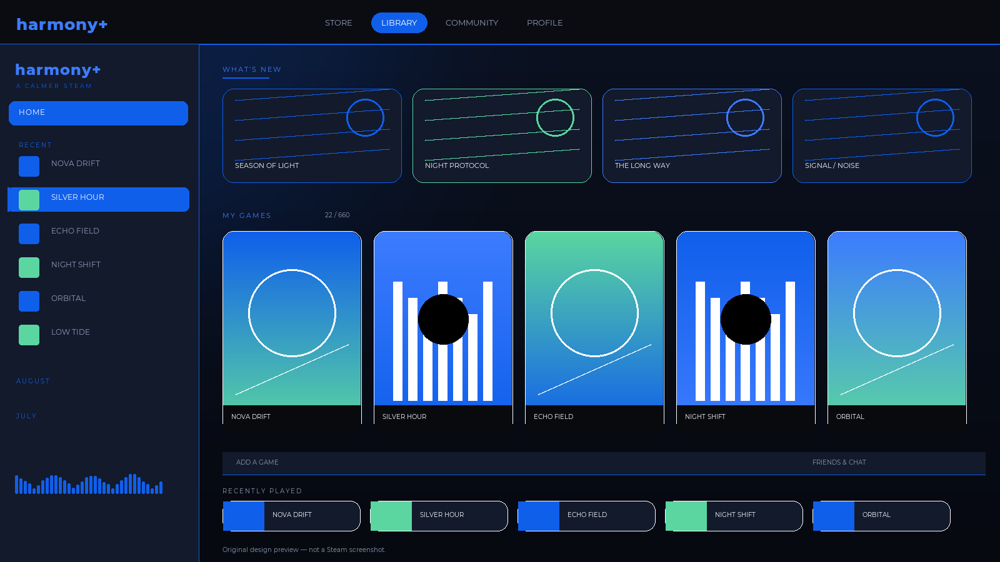

# Harmony+

**A calm, premium Fluent-inspired Steam theme for [Millennium](https://steambrew.app): deep midnight surfaces, milk-white type, rounded glass and the exact Harmony blue `#105FEB`.**



> Original theme code and artwork. Not affiliated with Valve, Microsoft, or any streaming service. The reference images supplied by the owner were used only to determine palette, weight and roundness; no third-party logo, wordmark or artwork is included.

---

## Status

| Area | Status |
| --- | --- |
| Source and metadata | Implemented (built from scratch — the workspace had no source) |
| Static validation (JSON/CSS/SVG/TTF/assets) | Passed |
| Steam + Millennium runtime — library, game details, Friends/Chat, Settings, store shell | Runtime tested |
| All five option groups loaded by Millennium | Runtime tested |
| Big Picture | Not yet verified |
| Full chat interaction matrix, DPI/multi-monitor, keyboard-only pass | Not yet verified |
| Community pages, store checkout | Not yet verified |

Detailed evidence: [VALIDATION_REPORT.md](VALIDATION_REPORT.md) and [AUDIT_REPORT.md](AUDIT_REPORT.md).

---

## Design brief preserved

- Accent/base blue is exactly **`#105FEB`**. It is not averaged, shifted or theme-tinted.
- Text is **milk-white** (`#F7F9FF`) with a soft secondary tone, not Steam’s default grey.
- Display typography is **Montserrat ExtraBold**, shipped as a real **TTF** (`assets/fonts/Montserrat-ExtraBold.ttf`, 455 KB, 2,747 glyphs, verified with fontTools). Regular and SemiBold TTFs are included for readable body copy.
- Windows 11 Fluent / Microsoft Store inspiration: layered glass, generous radii, restrained blue glow, 1px hairlines, soft shadows.
- Cozy, soothing, minimal and premium: no neon, no clutter, no aggressive contrast.
- Rounded buttons, inputs, panels, cards, chat elements and menus.
- A redesigned library rail with an original `harmony+` wordmark, uppercase section labels and a clear selected state.
- Compact / Cozy / Spacious density, Calm / Still motion, Soft / None ambient glow, Soft / Crisp radius, Montserrat / System typography.
- Steam Chat/Friends is styled without replacing any native control or behaviour. Presence colours remain Steam’s own.

### In-client frame

The theme adds a hairline Fluent frame and a cool top light **inside** the Steam web surface. The native Windows titlebar is outside Millennium’s reach and is not claimed to be replaced.

---

## Requirements

- Windows 10/11
- Steam desktop client with [Millennium](https://steambrew.app)
- Millennium with `Patches` and `Conditions` support (verified on Millennium Core 2.30.0)
- Steam desktop UI

Authored and tested against Steam changelist **11146165** (CEF 126).

---

## Installation

1. Download `Harmony-Plus-1.0.0.zip` from the releases page (or clone this repository).
2. Close Steam.
3. Extract so that `skin.json` is directly inside:

   ```
   %STEAM%\millennium\themes\HarmonyPlus\skin.json
   ```

   Default Windows path:

   ```
   C:\Program Files (x86)\Steam\millennium\themes\HarmonyPlus\
   ```

4. Start Steam.
5. Open **Steam → Settings → Millennium → Themes**, select **Harmony+**, and click **Use**.
6. Adjust density, motion, glow, radius and typography from the theme settings.

### Rollback

Close Steam, delete `%STEAM%\millennium\themes\HarmonyPlus`, and restart. Select your previous theme in Millennium.

### If the theme does not appear

- Confirm `skin.json` is at the root of the folder, not one level deeper.
- Confirm the folder name is `HarmonyPlus` and contains `libraryroot.custom.css`.
- Check `%STEAM%\millennium\logs\core_log.log` for theme load errors.
- Restart Steam after installing; Millennium discovers themes at startup.

---

## Options

| Option | Values | What it changes |
| --- | --- | --- |
| **Layout Density** | Compact, Cozy (default), Spacious | Library stage padding and panel padding |
| **Motion** | Calm (default), Still | Transition speed and hover lift; OS reduced-motion always wins |
| **Ambient Glow** | Soft (default), None | Blue atmosphere behind the library and game pages |
| **Corner Radius** | Soft (default), Crisp | Panel/control radii and navigation shape |
| **Typography** | Montserrat (default), System | Bundled Montserrat TTFs or Steam’s Motiva Sans |

All options are documented Millennium `Conditions`; each value loads a real stylesheet. No fake settings API, no inert switches.

---

## Architecture

`skin.json` uses a documented custom **`Patches`** list, not `UseDefaultPatches`, so the theme can also target store/community browser views. It does not combine `UseDefaultPatches` with `Patches` or `Steam-WebKit`.

```
Harmony+/
├── skin.json
├── libraryroot.custom.css     # main window material system
├── friends.custom.css         # Friends List + chat windows
├── bigpicture.custom.css      # Big Picture token remap
├── webkit.css                 # store/community browser views
├── options/                   # density, motion, glow, radius, typography
├── assets/
│   ├── fonts/                 # Montserrat TTF + OFL
│   ├── icons/                 # original SVG icon set
│   ├── logo-harmony.svg
│   └── previews/              # original design preview artwork
├── docs/DESIGN_RESEARCH.md
├── AUDIT_REPORT.md
└── VALIDATION_REPORT.md
```

### CSS quality

- Vanilla CSS only at runtime.
- Token system for surfaces, ink, accent, radii, spacing, shadows, motion and layers.
- Real Steam selectors verified in the installed client: `.TopBar`, `.LeftListSizableContainer`, `.SectionName`, `.LibraryItemBox`, `.PartnerEventRowCapsule`, `.PlayBar`, `.AppDetailsSection`, `.friendsui-container`, `.chatWindow`, `.TitleBar`, `.DialogButton`, `.contextMenuItem`.
- No global `*` colour/background/transform rules. The only universal selectors are in `prefers-reduced-motion` resets.
- No global SVG fill overrides. Original SVGs keep their own fills and strokes.
- No JavaScript. No polling, MutationObservers, injected overlays or repeated listeners.

---

## Compatibility and known limits

- Steam hashed class names can change between client updates. Semantic classes are preferred; report breakage with the Steam changelist.
- The native Windows titlebar cannot be replaced by a Millennium theme; the frame is in-client only.
- Big Picture is token/typography remapped, not fully redesigned, and is not runtime-verified here.
- Store/community pages load their own CSS after the theme, so `html body …` specificity is used. Checkout hierarchy is preserved; full checkout/community testing remains.
- Tested on Millennium Core 2.30.0. Newer 3.x releases should load the same documented schema, but the settings UI may differ.

---

## Development checks

```powershell
python _tools\validate_theme.py "Harmony+"
```

The validator checks metadata, all patch/condition targets, CSS parse errors, missing assets, SVG XML, TTF headers/metadata, and flags universal selectors and `.steamui_*` guesses.

---

## License

- Theme code and original artwork: **MIT** — see [LICENSE](LICENSE).
- Montserrat: **SIL Open Font License 1.1** — see `assets/fonts/Montserrat-OFL.txt`.
- Built for [Millennium](https://github.com/SteamClientHomebrew/Millennium), which is MIT-licensed. No Millennium code is bundled.

Harmony+ is an independent fan-made theme.
